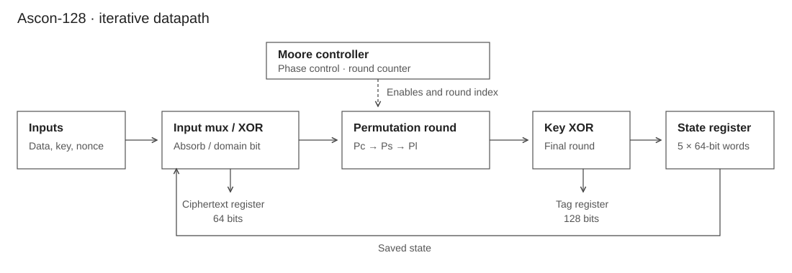

# Ascon-128 in SystemVerilog

A hardware implementation of Ascon-128 authenticated encryption, completed individually during my studies at Mines Saint-Étienne. The design combines an iterative 320-bit permutation datapath with a Moore state machine controlling initialization, associated data, encryption and tag generation.



## Project focus

This project brought together RTL design, bit-level transformations and sequential control:

- A 320-bit state organized as five 64-bit words.
- Round-constant addition, 64 parallel 5-bit S-boxes and word-wise diffusion.
- A shared permutation datapath reused across the encryption phases.
- A controller coordinating registers, key injection, data absorption and output capture.
- Simulation of the complete encryption sequence.

The core takes a 128-bit key, a 128-bit nonce and 64-bit input blocks. It produces ciphertext blocks and a 128-bit authentication tag. Padding and block sequencing are handled by the caller.

## Verified result

During portfolio preparation, **12 selected Ascon-128 v1.2 known-answer vectors passed** under Icarus Verilog 12.0. Both ciphertext and tag were compared with reference values. The RTL was retained without functional changes.

The cases cover associated-data lengths of 1, 7, 8 and 15 bytes, and plaintext lengths of 8, 16 and 23 bytes. This is a functional simulation result for that scope; no FPGA implementation, synthesis benchmark or timing closure is claimed.

This design targets **legacy Ascon-128 v1.2**, rather than the later Ascon-AEAD128 variant standardized in NIST SP 800-232. The versions have different conventions and must not share test vectors indiscriminately. See the [reference implementation notes](https://github.com/ascon/ascon-c#other-ascon-algorithms).

## Run the simulation

Requirements: Python 3 and Icarus Verilog 12.0, with `iverilog` and `vvp` available on `PATH`. The test runner uses only the Python standard library.

```sh
python3 scripts/run_sim.py
```

On Windows, use `python` with a compatible Icarus installation, or run the command in WSL. A successful run ends with:

```text
PASS: 12 known-answer vectors
```

The runner generates its testbench, simulator executable and waveform in the ignored `build/` directory. The reference vectors are included, so the test needs no network connection. See [simulation](docs/simulation.md) for the test procedure and [architecture](docs/architecture.md) for the hardware interface.

## Repository guide

| Path | Contents |
| --- | --- |
| [`rtl/`](rtl/) | Ascon core, controller, permutation and register modules |
| [`sim/rtl.f`](sim/rtl.f) | Ordered RTL compilation list |
| [`sim/vectors.json`](sim/vectors.json) | Selected public reference vectors |
| [`sim/archive/ascon_tb.sv`](sim/archive/ascon_tb.sv) | Original stimulus-based testbench |
| [`scripts/run_sim.py`](scripts/run_sim.py) | Automated ciphertext/tag checks added for this import |
| [`docs/`](docs/) | Architecture, interface and validation notes |

## Scope and limitations

The tested interface sequence requires non-empty associated data and at least one full plaintext block before finalization. Inputs must remain stable until the phase completes. The existing `cipher_valid_o` signal is not a one-cycle ready/valid handshake; the runner captures regular ciphertext at `end_cipher_o` and the final result at `end_tag_o`.

There is no decryption interface, tag-verification path, automatic padding or length field in this core. The repository does not establish side-channel resistance or suitability for a production security system.

## Portfolio provenance

This repository preserves an existing academic project. The original files were kept unchanged; the new documentation, diagram and automated verification were added on 19 October 2026. Git commits record the actual import and maintenance dates.

**Paul Guillemin** · Original source headers are preserved. No repository-wide license has been added.
